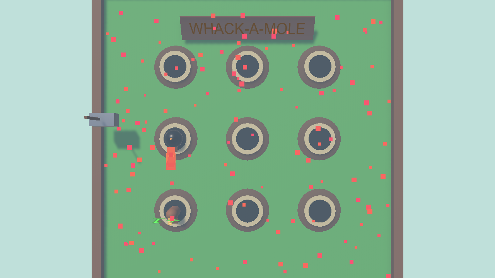
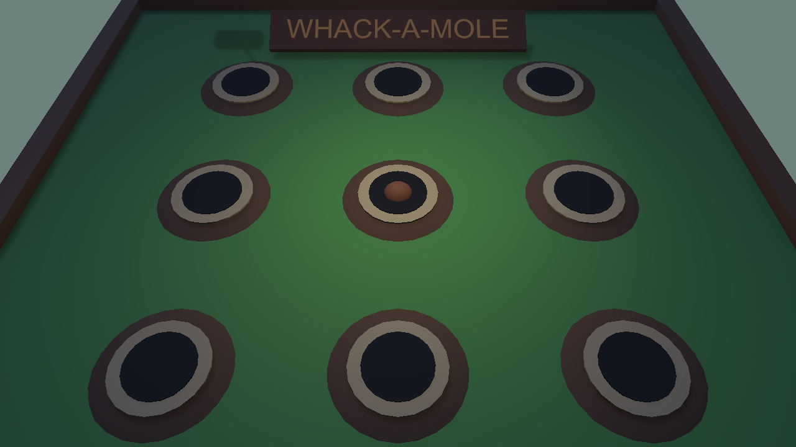
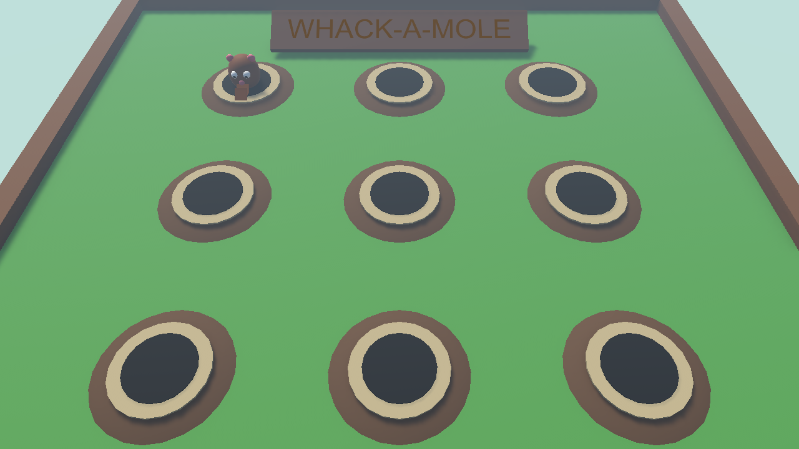
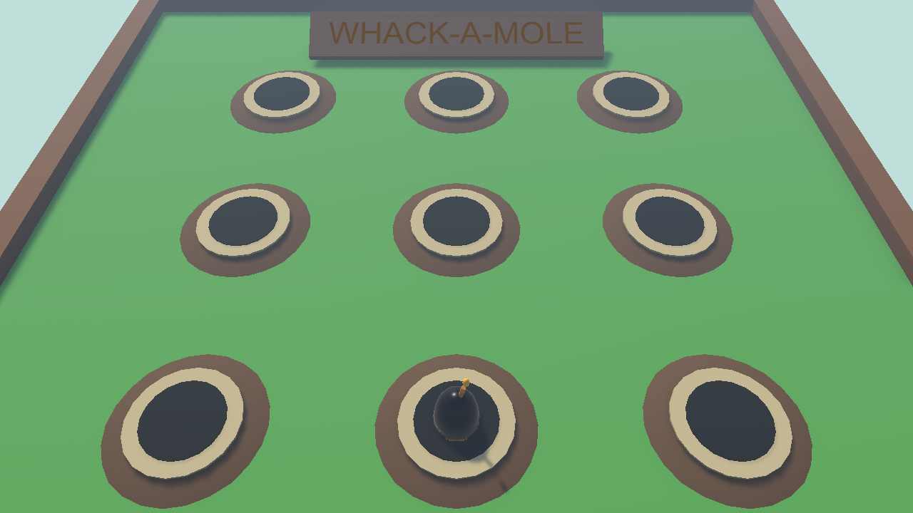
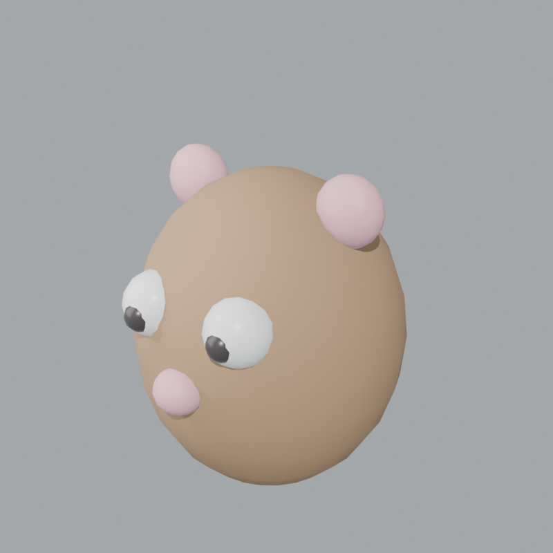
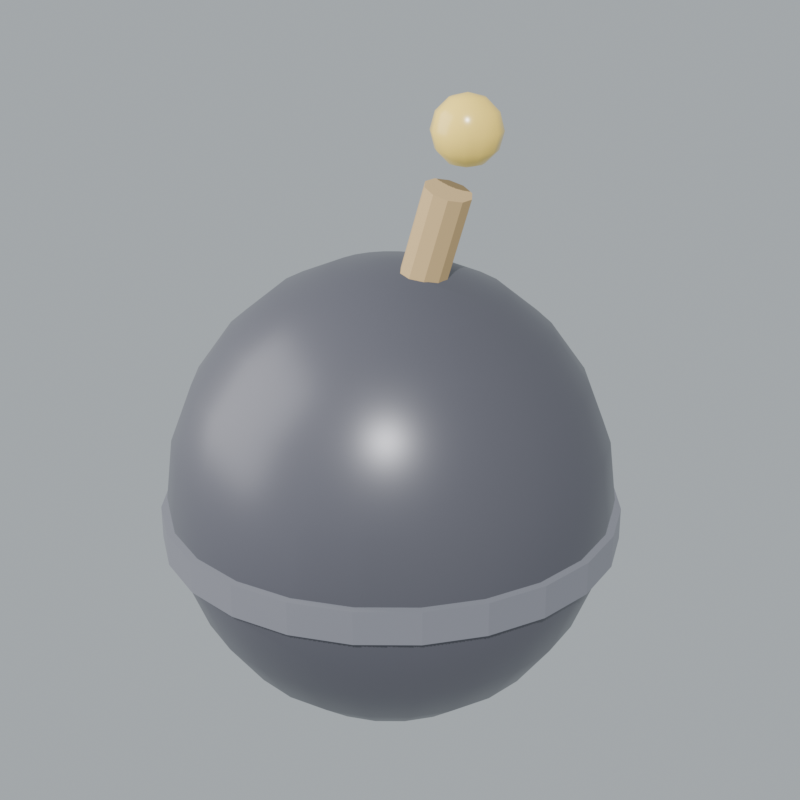
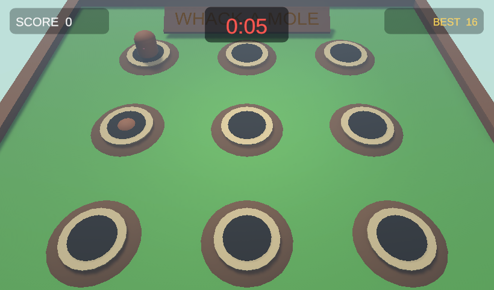

<div align="center">

# Whack-a-Mole 3D — Open Source Unity Arcade Game (URP)

**A complete, playable 3D whack-a-mole game made in Unity 6 with the Universal Render Pipeline.**
30-second rounds, physics hammer, particle effects, Q-learning and imitation-learning bots,
and a Google Cardboard VR mode — all in one C# project you can open and play in two clicks.

[](https://unity.com/)
[](https://docs.unity3d.com/Packages/com.unity.render-pipelines.universal@17.6/manual/index.html)
[](https://learn.microsoft.com/dotnet/csharp/)
[](https://www.blender.org/)
[](docs/DESIGN.md)
[](#license)

[Play](#how-to-run) · [Features](#features) · [Controls](#controls) · [Screenshots](#screenshots) · [Project layout](#project-layout) · [Design doc](docs/DESIGN.md)

</div>



## Table of contents

- [What is this project?](#what-is-this-project)
- [Features](#features)
- [Controls](#controls)
- [Requirements](#requirements)
- [How to run](#how-to-run)
- [Screenshots](#screenshots)
- [Project layout](#project-layout)
- [Rebuilding the models and sounds](#rebuilding-the-models-and-sounds)
- [Design document](#design-document)
- [Keywords / topics](#keywords--topics)
- [License](#license)
- [Notes](#notes)

## What is this project?

**Whack-a-Mole 3D** is a short single-player arcade game built in **Unity** with the
**Universal Render Pipeline**. Moles pop out of a 3x3 grid of holes and you hit as many as
you can before the 30-second clock runs out. Bombs hide in the grid too: hit one and you
lose two points.

It is meant to be a small but *complete* Unity game repository — a reference project for
gameplay programming, URP lighting and materials, particle and physics feedback, simple
reinforcement learning inside a game, and mobile VR with Google Cardboard. The mole and the
bomb are low-poly models authored in **Blender** and exported as FBX.

## Features

### Gameplay

- A 3x3 grid of holes on a wooden-bordered board, with a leaning "WHACK-A-MOLE" sign.
- Moles rise from a random free hole every 1.0 to 1.5 seconds, stay for a moment, then sink
  back. A hit is worth **+1**; a bomb is worth **-2** and the score never drops below zero.
- A **30-second round**. The HUD shows the score, the time left and the best score, and the
  timer turns red and pulses in the last five seconds.
- **Adaptive difficulty**: moles stay up for less time as the round goes on.
- Game over shows the final score and the best score, with a Restart button. The best score
  is saved between sessions with `PlayerPrefs`.

### Game feel

- Moles **stretch** as they pop out and **squash** flat when they are hit.
- Hits throw **sparks** and a floating "+1"; bombs **explode** with a camera shake and a
  "-2"; a new best score gets a **confetti** shower.
- **Dust puffs** when a mole starts to rise, four sound effects (pop, hit, bomb, cheer), and
  physics: the hit mole is thrown off the board instead of sinking politely.
- The hammer is a real **Rigidbody**: `Space` lifts and drops it, and whatever is under the
  head is hit.

### Scene controls

- **Day / night button** switches the sun colour and intensity, the ambient light, the fog,
  the skybox exposure and turns the point and spot lamps on only at night.
- **Colour button** repaints every mole through a palette of four body materials.

### Learning bots

Both bots are in-game, visible while you play, and described in [`docs/DESIGN.md`](docs/DESIGN.md):

- **Q-learning bot** — trains inside the game on a 9-hole observation and 10 actions, with a
  Q-table heat map, episode count and epsilon on screen.
- **Imitation bot** — records the player's decisions, trains a small model and then plays by
  copying them.

### VR

- **Google Cardboard** stereo view with head tracking and gaze selection (a centre reticle
  that fills over half a second). Testable in the Editor with mouse look.

## Controls

| Input | Action |
| --- | --- |
| Left click / tap | Hit the mole under the pointer |
| `Space` | Swing the physics hammer |
| `W A S D` | Move the hammer |
| `C` | Cycle camera: angled, top-down, close |
| `P` / `Esc` | Pause and resume |
| `R` | Restart the round |
| HUD buttons | Camera, day/night lighting, mole colour, pause |

## Requirements

| Item | Version |
| --- | --- |
| Unity Editor | 6000.6.9f1 |
| Render pipeline | Universal Render Pipeline 17.6.0 |
| UI | uGUI 2.6.0 + TextMeshPro |
| Input | Input System 1.20.1 |
| Blender (only to rebuild the models) | 5.2 LTS |

## How to run

1. Clone the repository:

   ```bash
   git clone https://github.com/Shivala-08/isd-online-game.git
   cd isd-online-game
   ```

2. Open the project folder with **Unity Hub** using editor **6000.6.9f1**.
3. Open `Assets/Scenes/Game.unity`.
4. Press **Play**.

If the scene, materials or prefabs are ever missing, rebuild them in one click:
**Whack-a-Mole → Build All**. The menu rebuilds the materials, the prefabs, the whole
scene and the HUD, so the game is playable again immediately.

## Screenshots

| Preview | Shows |
| --- | --- |
|  | Day play, hit sparks and the floating "+1" |
|  | Night lighting with the lamps on |
|  | The Blender mole in game |
|  | The Blender bomb in game |
|  | Mole model, plus `model_mole_wireframe.png` |
|  | Bomb model, plus `model_bomb_wireframe.png` |
|  | HUD states: `hud_normal.png`, `hud_danger.png`, `hud_gameover.png` |

## Project layout

```
Assets/
  Scenes/      Game.unity
  Scripts/
    Core/      GameManager, MoleSpawner
    Gameplay/  Mole, Bomb, HoleOccupant, Hammer, HitRaycaster, HitEffects,
               CameraCycler, CameraShaker
    UI/        HUDController, UIController, LightPanel, MaterialSwapper, ScorePopup
    AI/        MoleEnv, QLearningAgent, QTableView, DemoRecorder, ImitationBot
    VR/        GazePointer
    Editor/    SceneBuilder, ScreenshotTool
  Prefabs/     Mole, Bomb, Hole, HitBurst, DustPuff, Explosion, Confetti, Hammer, ScorePopup
  Prefabs/UI/  StartCard, PauseCard, GameOverCard
  Materials/   URP Lit materials for every surface and effect
  Models/      Mole.fbx, Bomb.fbx, Characters.blend
  Audio/       SFX_Pop, SFX_Hit, SFX_Bomb, SFX_Cheer
  Settings/    URP assets, renderer and volume profile
docs/DESIGN.md          game design, gameplay rules, AI and VR notes, test plan
tools/build_models.py   builds and exports the Blender models
tools/make_sfx.py       synthesises the four sound effects
Screenshots/            report evidence
```

## Rebuilding the models and sounds

```bash
/Applications/Blender.app/Contents/MacOS/Blender -b -P tools/build_models.py
python3 tools/make_sfx.py
```

The model script rewrites `Assets/Models/*.fbx` plus four preview renders (solid and
wireframe for each model); run **Whack-a-Mole → Build All** afterwards to put the new meshes
into the prefabs. If a model file is missing, the builder falls back to primitive shapes, so
the project still builds.

## Design document

[`docs/DESIGN.md`](docs/DESIGN.md) covers the game design, gameplay rules, the Q-learning and
imitation-learning bots, the VR notes and the test plan.

## Keywords / topics

Unity game · Unity 6 · Universal Render Pipeline · URP · C# game development · 3D arcade
game · whack-a-mole · reflex game · physics hammer · particle effects · TextMeshPro ·
reinforcement learning · Q-learning · imitation learning · game AI · Google Cardboard VR ·
mobile VR · Blender low-poly modelling · open source Unity project · game design document.

## License

MIT — see [`LICENSE`](LICENSE).

## Notes

- **Graphics:** everything uses URP shaders only. A material's colour is set on
  `_BaseColor`; `_Color` belongs to the built-in pipeline and does nothing here.
- **Input:** the project uses the new Input System only, so pointer and keyboard state are
  read through `Mouse.current`, `Touchscreen.current` and `Keyboard.current`.
- **Sounds:** the four effects are generated by `tools/make_sfx.py`, so no audio package is
  needed.
- **Editor background:** on macOS the Editor may pause the Play-mode loop while its window
  is not frontmost. Focus the Unity window before starting a round.
